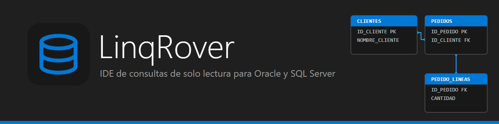
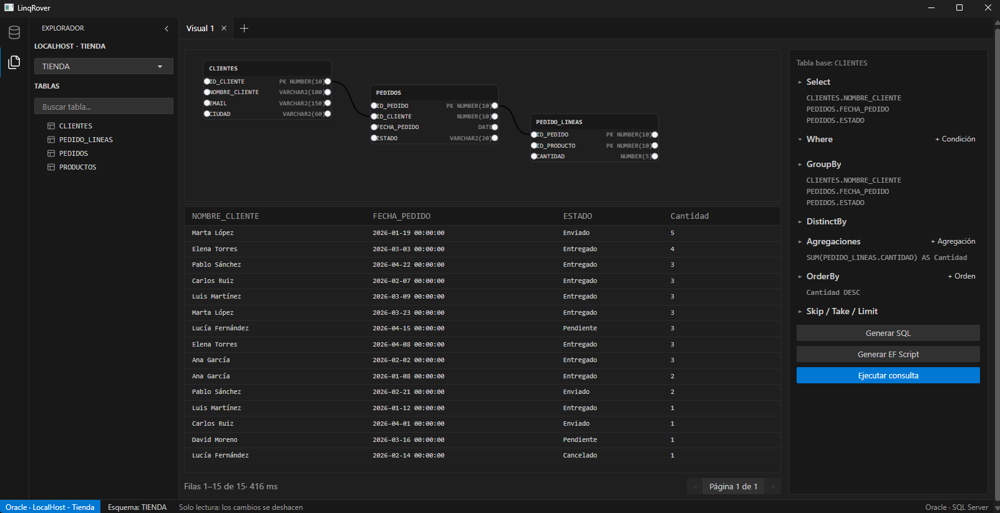

# LinqRover

IDE de consultas de solo lectura para **Oracle** y **SQL Server**, con una interfaz al estilo de VS Code (tema «Dark Modern»).

La aplicación es una ventana de escritorio para Windows hecha con .NET 10: la interfaz es Blazor, y la ventana y el WebView se gestionan con [Rustino](https://github.com/EdoardoTona/Rustino) (`EdoardoTona.Rustino.Blazor`).

## Qué hace

- **Conexiones guardadas**: nombre, motor, host, puerto, base de datos, usuario y contraseña. Se guardan cifradas (ver [Dónde se guardan](#dónde-se-guardan-las-conexiones)).
- **Explorador de tablas**: esquema, lista de tablas con búsqueda y columnas al pasar el ratón.
- **Detalle de tabla**: datos paginados (30 filas), esquema de columnas y diagrama de relaciones (claves foráneas).
- **Pestañas de consulta**:
  - **SQL**: editor con autocompletado de tablas y columnas, historial y Ctrl+Enter para ejecutar.
  - **EF Script**: script C# sobre EF Core, con autocompletado de Roslyn, y «Ver SQL» para ver el SQL que generaría sin ejecutarlo.
  - **Editor visual**: diagrama de tablas (arrastrar desde el explorador), uniones por columnas, `Select`, `Where`, `GroupBy`, `DistinctBy`, `OrderBy` (ASC/DESC, también sobre agregaciones), agregaciones y `Skip`/`Take`/`Limit`. Genera SQL o EF Script y permite ejecutar la consulta.
- **Resultados**: tabla paginada con el tiempo de ejecución al pie. Se puede cambiar la altura del panel de resultados arrastrando la barra que lo separa del editor o del diagrama.

**Solo lectura:** las consultas y los scripts se ejecutan dentro de una transacción que siempre se deshace, y `SaveChanges` está bloqueado en el contexto de EF. Las consultas SQL que parecen modificar datos piden confirmación antes de ejecutarse.

## Capturas

Editor visual sobre la base de datos de ejemplo «Tienda» (Oracle 11g): tablas unidas por sus claves, columnas en `Select` y `GroupBy`, una agregación (`SUM` de cantidades por cliente), orden por la cantidad descendente y el resultado debajo. Las secciones plegadas muestran solo lo que tienen activado.

<p align="center">
  
</p>

## Requisitos

- Windows 10 (19041) o superior, con el runtime de **WebView2** (viene instalado en Windows 10 y 11).
- **.NET 10 SDK**.
- **Node.js**, solo para compilar los estilos (Tailwind + DaisyUI) y copiar Monaco.

## Puesta en marcha

Instala las dependencias de Node una vez, dentro del proyecto de la interfaz:

```bash
npm install --prefix src/LinqRover.Rustino
```

Compila y ejecuta:

```bash
dotnet build LinqRover.slnx
dotnet run --project src/LinqRover.Rustino/LinqRover.Rustino.csproj
```

El build genera `wwwroot` del proyecto copiando los recursos de la interfaz en cada compilación. Monaco se copia desde `node_modules` (solo SQL y C#, para mantener la publicación pequeña).

### Configuración opcional (`.env`)

Puedes crear un archivo `.env` en la raíz del repositorio (o en una carpeta superior a la del ejecutable) para rellenar por defecto el formulario de nueva conexión. Es solo para desarrollo y no se sube a git:

```
LR_ENGINE=SqlServer
LR_HOST=localhost
LR_PORT=1433
LR_DB=mi_base
LR_USER=usuario
LR_PASS=contraseña
LR_TRUST_CERT=1
```

## Publicar

Los scripts publican la aplicación en `./build` como **ejecutable único autocontenido** (incluye el runtime de .NET, no hace falta instalarlo), en Release y sin archivos `.pdb`:

```bash
./publish.sh          # Git Bash / Linux
publish.cmd           # Windows (CMD o Explorador)
```

Para el archivo único se usa `PublishSingleFile`; `wwwroot` queda junto al ejecutable.

## Dónde se guardan las conexiones

Las conexiones se guardan en:

```
(carpeta del ejecutable)/profiles/(usuario de Windows).json
```

El archivo completo está **cifrado con DPAPI** para el usuario de Windows que lo crea: no se puede leer desde otra cuenta ni en claro en el disco. La carpeta `profiles` se crea al arrancar. Si ya tienes un archivo en texto plano en esa ruta, se lee y se vuelve a guardar cifrado al cargar las conexiones.

Al cerrar la ventana, el proceso termina por completo.

## Estructura

```
LinqRover.slnx
src/
  LinqRover.Core/          Proveedores de base de datos (Oracle, SQL Server), modelos,
                           almacenamiento de conexiones y generación de scripts EF Core.
  LinqRover.QueryBuilder/  Editor visual de consultas (diagrama, formulario y generadores).
  LinqRover.Rustino/       Aplicación: interfaz Blazor (Components, Services, wwwroot,
                           Styles), Tailwind/DaisyUI y host de Rustino (Program.cs).
publish.sh / publish.cmd  Publicación en ./build.
```

## Tecnologías

- .NET 10, Blazor (componentes Razor) y Rustino sobre WebView2.
- Monaco Editor para SQL y C#, con Roslyn para el autocompletado de scripts EF.
- Entity Framework Core y los proveedores de Oracle y SQL Server.
- Tailwind CSS y DaisyUI, con un tema propio inspirado en VS Code «Dark Modern».
- Z.Blazor.Diagrams para los diagramas de tablas.
